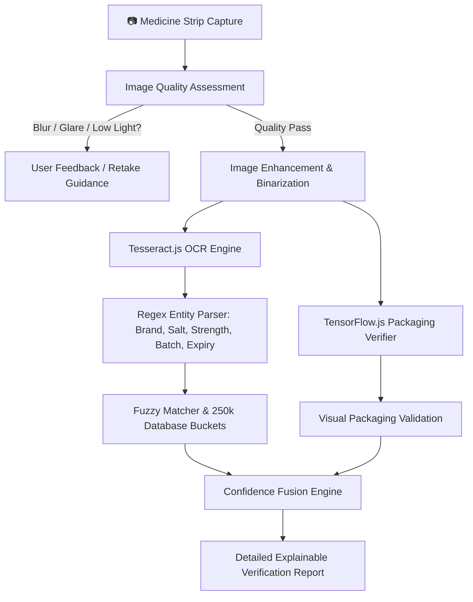

# 🩺 MediVerify — Medicine Stripper Edge AI

> **Next-Generation, Privacy-Preserving On-Device Medicine Verification & Identification Powered by Edge AI and Computer Vision.**

[](LICENSE)
[](https://reactjs.org/)
[](https://www.typescriptlang.org/)
[](https://vitejs.dev/)
[](https://www.tensorflow.org/js)
[](https://tailwindcss.com/)
[](https://web.dev/progressive-web-apps/)

---

## 🌟 Overview

Counterfeit, mislabeled, and expired medications pose serious risks to global public health. Traditional verification systems rely heavily on cloud APIs, creating critical latency issues, requiring continuous internet connectivity, and raising sensitive patient privacy concerns.

**MediVerify (Medicine Stripper Edge AI)** solves this with a **100% client-side, offline-first multi-modal Edge AI verification engine**. Operating entirely within the user's browser, MediVerify combines real-time computer vision, Optical Character Recognition (OCR), explainable fuzzy knowledge retrieval over 250,000+ medicines, and neural packaging verification to authenticate blister packs and medicine strips in seconds.

---

## 🚀 Key Features

- 🔒 **100% Private & On-Device**: Scans, photos, and medical metadata are processed locally in the browser via WebAssembly (Wasm) and WebGL. Zero image data is transmitted to external servers.
- 📴 **Offline-First PWA Architecture**: Operates without an active internet connection using a partitioned chunk-based IndexedDB database and service worker caching.
- 👁️ **Client-Side Computer Vision & OCR**:
  - Pre-capture and post-capture image quality assessment (detects blur, glare, poor lighting, and skewed angles).
  - Adaptive contrast enhancement and binarization for metallic foil reflection suppression.
  - On-device Tesseract.js OCR engine extracting brand name, active salt composition, dosage strength, batch number, and manufacturing/expiry dates.
- 🧠 **Explainable Multi-Modal AI Fusion**:
  - Synthesizes OCR typography signals, visual packaging classification, and database verification.
  - Transparent confidence breakdown (OCR score, Packaging visual score, Salt match certainty, and Expiry validity).
- 📚 **Extensive Knowledge Base**:
  - Pre-indexed database of **250,554+ medicines** with active salt compositions, manufacturer data, substitutes, dosage formats, and side effects.
  - Sub-millisecond fuzzy search queries powered by Fuse.js and partitioned index buckets.
  - Hybrid fallback: Optional openFDA API integration when online to retrieve supplementary drug monograph info.
- 📱 **Responsive & Modern UI**: Built with a sleek dark-mode glassmorphism aesthetic, fluid Framer Motion micro-interactions, camera guidelines, and audio/haptic feedback.

---

## 🔬 Multi-Modal Verification Pipeline



### 1. Image Quality Assessment
Evaluates camera feed or uploaded photo frames for brightness, contrast, specular glare on blister foils, and Laplacian blur.

### 2. Adaptive Preprocessing
Applies grayscale transformation, local contrast stretching, and adaptive binarization to extract clean typography from reflective aluminum foil packaging.

### 3. OCR Primary Extraction
Runs on-device WebAssembly OCR workers to parse text blocks and detect key pharmaceutical entities:
- **Brand Name** (e.g., *Dolo 650*, *Augmentin 625 Duo*)
- **Active Salts / Ingredients** (e.g., *Paracetamol / Acetaminophen*)
- **Strength & Form** (e.g., *650 mg*, *Tablet / Capsule*)
- **Batch Number & Expiry Date** (flags expired products automatically)

### 4. Fuzzy Retrieval & Partitioned Buckets
Queries partitioned alphanumeric buckets across 250,554 medicines. Employs Levenshtein and Trigram distance fuzzy matching to accurately identify medications even in the presence of OCR typos or damaged packaging.

### 5. Neural Packaging Verification
A TensorFlow.js vision model inspects the physical packaging characteristics (strip layout, blister count, foil color scheme, and typography layout) against reference signatures.

### 6. Confidence Fusion Engine
Produces a unified authenticity score with granular explainability metrics:
- **High Confidence (85%+)**: Authentic match confirmed.
- **Moderate Confidence (60%–84%)**: Candidate identified; manual inspection recommended.
- **Low Confidence (<60%)**: Unverified packaging or unidentifiable scan.

---

## 🛠️ Tech Stack

| Layer | Technology |
|---|---|
| **Core Framework** | React 18, TypeScript, Vite 5 |
| **Styling & Design** | Tailwind CSS v3, Framer Motion, Lucide Icons |
| **Edge Machine Learning** | TensorFlow.js (Wasm / WebGL backends) |
| **Optical Character Recognition** | Tesseract.js (WebAssembly OCR engine) |
| **Search & Retrieval** | Fuse.js (Fuzzy Matching Engine) |
| **Client Storage** | IndexedDB via `idb` |
| **Offline / PWA** | `vite-plugin-pwa`, Service Workers, Cache API |
| **External Integration** | openFDA API (Optional online fallback) |

---

## 📁 Repository Structure

```
Medicine-Stripper-Edge-AI/
├── public/                 # Static assets and Tesseract language files
├── scripts/                # Database extraction, bucket generators, and data tooling
│   ├── build_medicine_db.py  # Generates chunked 250k medicine dataset
│   ├── make_buckets.py       # Partitions database into indexed buckets
│   ├── verify_db.py          # Validates dataset integrity and indices
│   └── search_db.js          # CLI verification search utility
├── src/
│   ├── components/         # Reusable UI components (Navbar, Camera, Cards, Modals)
│   ├── database/           # 500+ partition chunks and bucket indices
│   │   ├── chunks/           # Chunked JSON records for lazy-loading
│   │   ├── index_buckets/    # Alphabetical search index buckets
│   │   └── db_meta.json      # Dataset metadata and stats
│   ├── hooks/              # Custom React hooks (useCamera, useScanner, etc.)
│   ├── pages/              # Primary application views
│   │   ├── Home.tsx          # Dashboard, quick search, recent history
│   │   ├── Scanner.tsx       # Real-time camera scanner & upload interface
│   │   ├── VerificationReport.tsx # Multi-modal analysis breakdown
│   │   ├── MedicineDetails.tsx    # Comprehensive drug monographs
│   │   ├── SearchHistory.tsx # Saved scans and verification logs
│   │   ├── Settings.tsx      # Config (Edge AI thresholds, dark mode, cache)
│   │   └── About.tsx         # Architectural overview and specifications
│   ├── services/           # Core Edge AI services
│   │   ├── ai/               # TF.js packaging verifier models
│   │   ├── cache/            # IndexedDB cache service
│   │   ├── database/         # Database loader and chunk retrieval
│   │   ├── imageEnhancement/ # Foil glare reduction and adaptive thresholding
│   │   ├── imageQuality/     # Blur, contrast, and brightness evaluator
│   │   ├── matching/         # Fuzzy string matching and score weighting
│   │   ├── ocr/              # Tesseract worker runner and regex entity extraction
│   │   ├── online/           # openFDA client and fallback knowledge retrieval
│   │   └── verification/     # Confidence fusion engine and report generation
│   ├── store/              # Zustand application state management
│   ├── types/              # TypeScript interfaces and schema declarations
│   ├── utils/              # Formatting, math, and validation utilities
│   ├── App.tsx             # Root routing and theme provider
│   └── main.tsx            # Application entrypoint
├── test_samples/           # Sample medicine strip images for testing
├── package.json            # Dependencies and npm scripts
├── tsconfig.json           # TypeScript configuration
└── vite.config.ts          # Vite build and PWA configuration
```

---

## ⚡ Getting Started

### Prerequisites

- [Node.js](https://nodejs.org/) (version 18.0 or higher recommended)
- [npm](https://www.npmjs.com/) or [yarn](https://yarnpkg.com/)
- [Python 3.8+](https://www.python.org/) (optional, only required if rebuilding the database from raw CSVs)

### Installation

1. **Clone the repository:**
   ```bash
   git clone https://github.com/MeiyappanKailasam/Medicine-Stripper-Edge-AI-.git
   cd Medicine-Stripper-Edge-AI-
   ```

2. **Install dependencies:**
   ```bash
   npm install
   ```

3. **Start the local development server:**
   ```bash
   npm run dev
   ```
   Open your browser and navigate to `http://localhost:5173`.

4. **Build for production:**
   ```bash
   npm run build
   ```

5. **Preview the production build locally:**
   ```bash
   npm run preview
   ```

---

## 🧪 Testing with Sample Images

A sample medicine strip image is included in `test_samples/`:
- `test_samples/dolo_650_strip.jpg` — High-resolution sample of Paracetamol 650mg blister pack.

You can upload this directly in the **Scanner** tab (`/scanner`) to evaluate the OCR pipeline, salt extraction, and verification scoring.

---

## ⚙️ Configuration & Customization

Through the **Settings** view (`/settings`), users and developers can fine-tune:
- **Minimum Match Confidence Threshold**: Adjust the verification sensitivity.
- **Offline / Cloud Hybrid Mode**: Toggle offline-only vs. openFDA fallback enrichment.
- **Theme**: Dark mode / Light mode toggle.
- **Local Cache Management**: View and clear cached database chunks and recent scans.

---

## ⚠️ Medical & Legal Disclaimer

> **IMPORTANT**: MediVerify is designed for informational, educational, and verification-assistance purposes only. It is **not a substitute for professional medical advice, diagnosis, or clinical pharmaceutical testing**. Always consult a licensed healthcare professional or pharmacist if you suspect a medicine has been tampered with or is counterfeit.

---

## 📄 License

This project is open-source and distributed under the [MIT License](LICENSE).
The pharmaceutical database is indexed from open-source datasets under [CC BY-SA 4.0](https://creativecommons.org/licenses/by-sa/4.0/).
